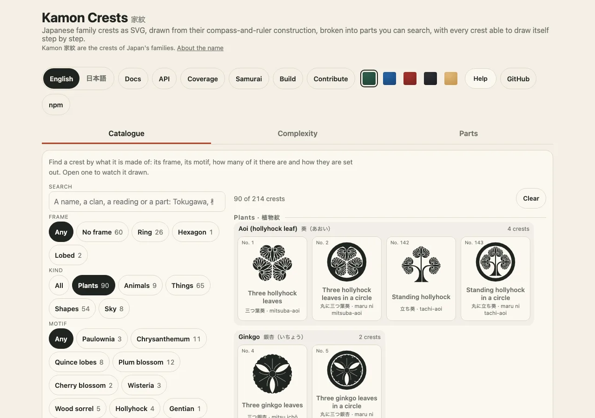
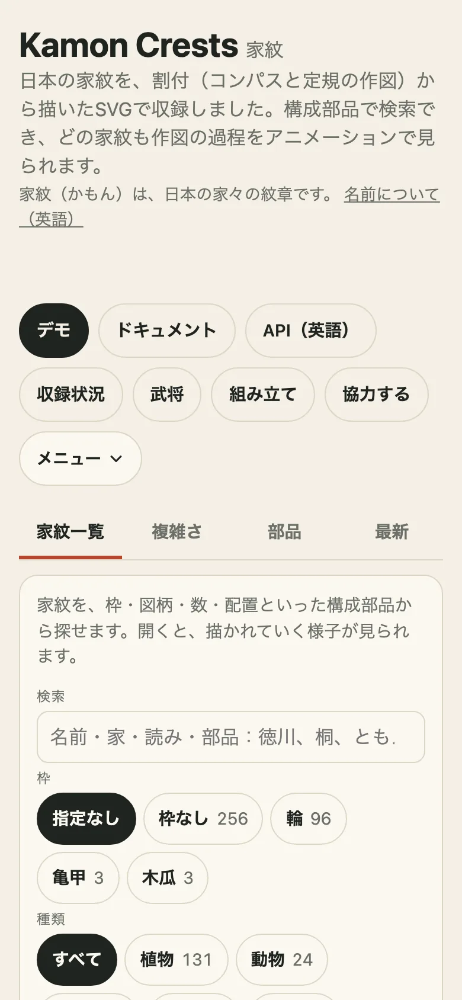
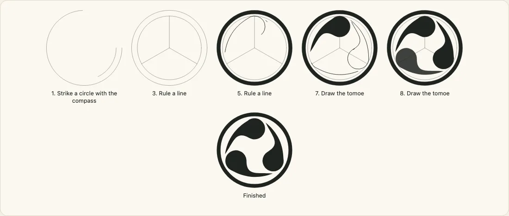
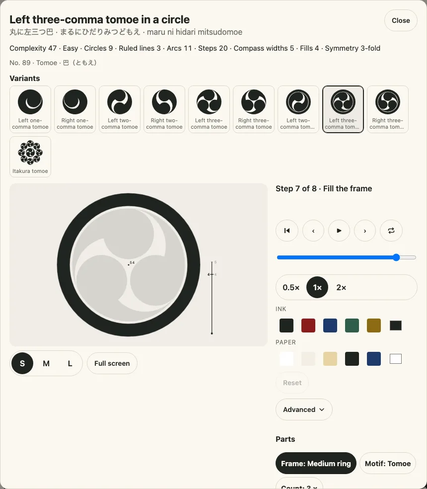
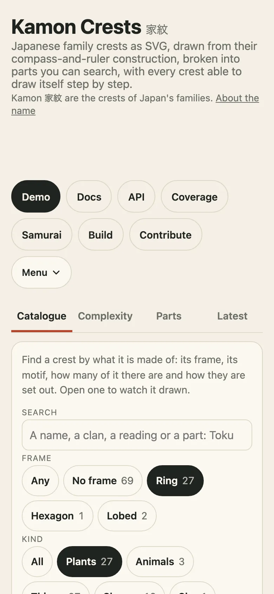
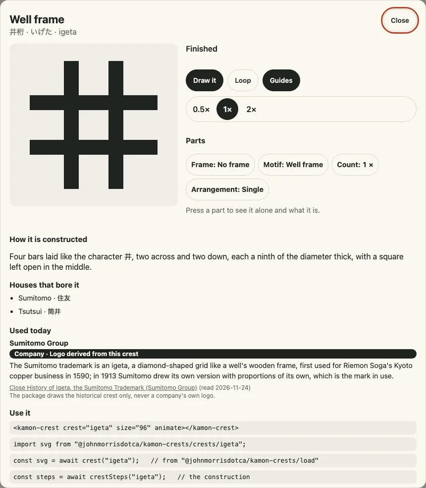
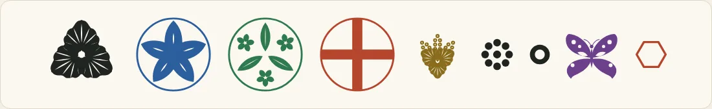
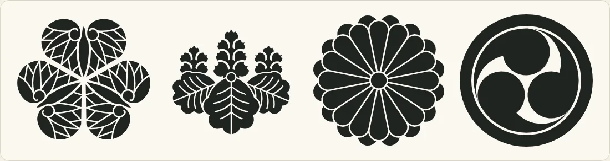
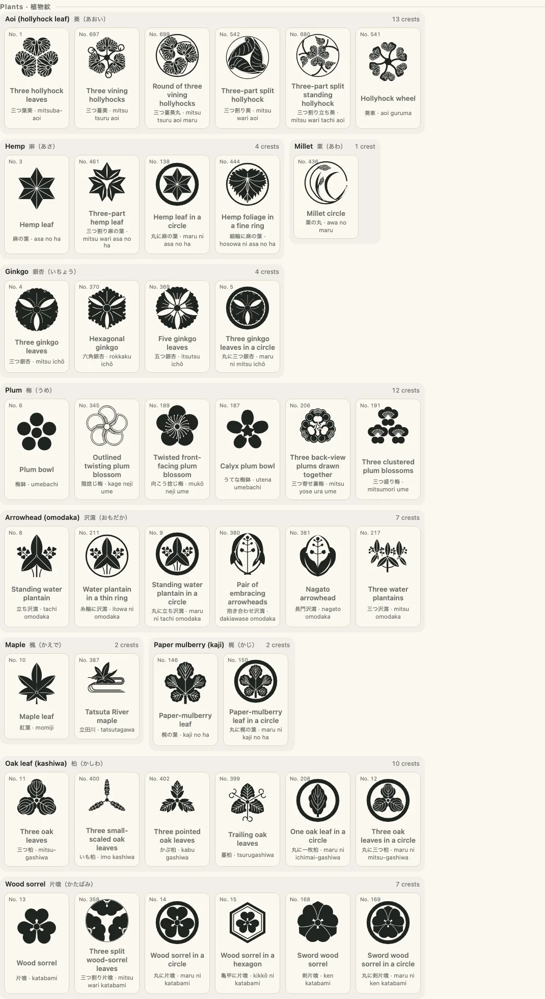

<h1 align="center">Kamon Crests <sub>家紋</sub> — Japanese family crests as SVG</h1>

<p align="center"><strong>Kamon 家紋: Japanese family crests as SVG, drawn from the compass-and-ruler construction each one is made by, and broken into parts a site can search.</strong><br>
Every crest is described by its frame, its motif, how many of it there are and how they are arranged, so a page can ask for every crest with paulownia, every ringed crest, every crest with three of something. One module per crest, a lookup that loads one by its id, a <code>&lt;kamon-crest&gt;</code> element to embed one anywhere, and a construction animation for every crest: the compass circles and ruler lines, each shape traced and filled in, the guides rubbed out. Zero dependencies.</p>

<p align="center" lang="ja">日本の家紋を、割付（コンパスと定規による作図）や、著作権の切れた明治の紋帳から描き起こしたSVGで収録し、枠・図柄・数・配置といった構成部品で検索できるようにした、依存関係のない TypeScript パッケージです。どの家紋も、作図の過程をアニメーションで見られます。</p>

<p align="center">
  <a href="https://github.com/johnmorrisdotca/kamon-crests/actions/workflows/ci.yml"></a>
  <a href="https://www.npmjs.com/package/@johnmorrisdotca/kamon-crests"></a>
  <a href="./LICENSE"></a>
  
  
  <a href="https://www.npmjs.com/package/@johnmorrisdotca/kamon-crests#provenance"></a>
</p>

<p align="center"><a href="https://johnmorrisdotca.github.io/kamon-crests/"><strong>Try it →</strong></a> · <a href="https://johnmorrisdotca.github.io/kamon-crests/api.html">API reference</a> · <a href="./docs/guides/getting-started.md">Getting started</a> · <a href="./docs/guides/how-crests-are-constructed.md">How crests are constructed</a> · <a href="./docs/guides/ja/getting-started.md">日本語のガイド</a></p>

<p align="center">
<picture>
<source media="(prefers-color-scheme: dark)" srcset="https://raw.githubusercontent.com/johnmorrisdotca/kamon-crests/main/docs/images/hero-desk-dark.webp">

</picture>
<br><em>The catalogue on a desk: the filters on the left, the crests that match on the right.</em>
</p>

<p align="center">
<picture>
<source media="(prefers-color-scheme: dark)" srcset="https://raw.githubusercontent.com/johnmorrisdotca/kamon-crests/main/docs/images/hero-phone-dark.webp">

</picture>
<br><em>The catalogue on a phone, in Japanese.</em>
</p>

Kamon Crests is the crest set a site can add when it wants a family crest as a real vector, not a clip-art picture: 61 crests, every one drawn for this package: the geometric ones from the construction (割付, *wari-tsuke*) that their shape is set out by, with the circles struck with a compass and the lines ruled, and the leaves and flowers vectorised from public-domain Meiji crest books and made exactly symmetric, at proportions and line weights that are the same from one crest to the next. Each crest is a module of its own, so a page carries only the crests it imports.

## The best of it

- **Drawn from the construction, or from a period crest book.** A geometric crest is a handful of circles, arcs, lines and curves placed by the rules that crest has always been drawn by. A leaf or flower crest is vectorised from a public-domain crest book of 1892 at the National Diet Library, cleaned into smooth curves and mirrored or turned exactly, with the book, the frame and the place on the page cited for each ([provenance](./docs/provenance.md)). Nothing embeds a raster, and the paths are clean at any size ([how crests are constructed](./docs/guides/how-crests-are-constructed.md)).

<p align="center">
<picture>
<source media="(prefers-color-scheme: dark)" srcset="https://raw.githubusercontent.com/johnmorrisdotca/kamon-crests/main/docs/images/construction-desk-dark.webp">

</picture>
<br><em>Every crest can draw itself: the compass circles and ruler lines first, then each shape traced and filled in, then the guides rubbed out.</em>
</p>

- **Searchable by parts.** The frame, the motif, the count and the arrangement are data, so a site can find every crest with paulownia, every ringed crest, every crest with three of something, or every crest a company uses today ([the parts](./docs/guides/parts-and-search.md)).

<p align="center">
<picture>
<source media="(prefers-color-scheme: dark)" srcset="https://raw.githubusercontent.com/johnmorrisdotca/kamon-crests/main/docs/images/parts-desk-dark.webp">

</picture>
<br><em>A crest taken apart: press a part to see it alone and what it is.</em>
</p>

<p align="center">
<picture>
<source media="(prefers-color-scheme: dark)" srcset="https://raw.githubusercontent.com/johnmorrisdotca/kamon-crests/main/docs/images/search-phone-dark.webp">

</picture>
<br><em>Narrowing by parts on a phone: ringed crests of a plant.</em>
</p>

- **Who uses it today, with the source.** Where a public page says that a company's mark descends from a crest, or a house still uses it, the record says so, with the page and the day it was read ([used today](./docs/guides/used-today.md)).

<p align="center">
<picture>
<source media="(prefers-color-scheme: dark)" srcset="https://raw.githubusercontent.com/johnmorrisdotca/kamon-crests/main/docs/images/used-desk-dark.webp">

</picture>
<br><em>Present-day users are stated as facts with a source, never drawn: the package draws the crest, not anyone's logo.</em>
</p>

- **`<kamon-crest>`, one tag in any page.** Change `crest`, `size` or `color`, add `animate` to draw it step by step, and the crest follows, with no framework and no bundler ([embed it](#4-embed-it-anywhere)).

<p align="center">
<picture>
<source media="(prefers-color-scheme: dark)" srcset="https://raw.githubusercontent.com/johnmorrisdotca/kamon-crests/main/docs/images/element-desk-dark.webp">

</picture>
<br><em>The same tag with a different id, size and colour: the crest takes the colour of the page's text unless told otherwise.</em>
</p>

## In 30 seconds

```sh
npm install @johnmorrisdotca/kamon-crests
```

```ts
import aoi from "@johnmorrisdotca/kamon-crests/crests/mitsuba-aoi";  // one crest, one module
import { crest, crestSteps } from "@johnmorrisdotca/kamon-crests/load";
import { findCrests } from "@johnmorrisdotca/kamon-crests/search";

element.innerHTML = aoi;                          // an <svg> with a viewBox: it fills its box, in the text colour
const kikyo = await crest("kikyo", { color: "#2b5f9e" }); // any crest by its id, loaded when asked
const steps = await crestSteps("kikyo");          // how it is constructed, step by step
findCrests({ motif: "paulownia" });               // every crest with paulownia
await crest("nope");                              // null: not the id of a crest
```

```html
<script type="module" src="https://cdn.jsdelivr.net/npm/@johnmorrisdotca/kamon-crests@0/dist/element-define.js"></script>
<kamon-crest crest="sasa-rindo" size="96" animate></kamon-crest>
```

Install the scoped name: an unscoped `kamon-crests` on npm, if there is one, is somebody else's package.

## Who it is for

- **Sites about Japan, its history or its families**: genealogy pages, castle and clan guides, museum and shrine sites, which need a crest as a clean vector beside a name.
- **Games and quizzes** that show a clan's crest, or ask which crest has three leaves.
- **Designers and teachers** who want to show how a crest is built, and can let the crest draw itself.
- **Developers** who need crests in a page with one script tag, or as modules in a bundle that carries only the crests it shows.
- **Anybody who has to say where a drawing came from**: every drawing is made for this package, and the licence is MIT.

## Features

- 61 crests: clan crests (Tokugawa, Takeda, Sanada, Oda, Shimazu, Hojo, Mori, Ashikaga and others), the paulownia and chrysanthemum, and the plants, animals, objects and plain shapes the crests are made of.
- A vocabulary of parts, in English and Japanese with readings, and every crest described by it.
- A construction animation for every crest, as plain SVG and CSS.
- One module per crest, a lookup that loads a crest by its id, and a manifest with names, readings, houses and present-day users.
- A search by parts, names, readings, houses and users.
- A `<kamon-crest>` custom element, with colour, size, animation, speed, loop and replay, and `controls` to pause, step and scrub the drawing.
- Zero dependencies, ESM, TypeScript types.

### What's in it

| What | How many |
| --- | --- |
| Crests | 61 |
| Crests in a ring | 20 |
| Crests of a plant | 31 |
| Crests of an animal | 4 |
| Crests of a made thing | 16 |
| Crests of a plain shape | 10 |
| Motifs in the vocabulary | 40 |
| Crests with a present-day user, with its source | 3 |

<p align="center">
<picture>
<source media="(prefers-color-scheme: dark)" srcset="https://raw.githubusercontent.com/johnmorrisdotca/kamon-crests/main/docs/images/large-desk-dark.webp">

</picture>
<br><em>Four crests at 250 pixels: the lines, the curves and the veins stay clean.</em>
</p>

<p align="center">
<picture>
<source media="(prefers-color-scheme: dark)" srcset="https://raw.githubusercontent.com/johnmorrisdotca/kamon-crests/main/docs/images/catalogue-desk-dark.webp">

</picture>
<br><em>Every crest of the catalogue, as the demo shows it.</em>
</p>

## Use it in your project

### Install

```sh
npm install @johnmorrisdotca/kamon-crests
```

Node 24 or later on a server; any current browser. The package has no runtime dependencies and makes no network request of its own.

### The entries

| Import | What it carries |
| --- | --- |
| `@johnmorrisdotca/kamon-crests` | The ids, `crestId`, `crestUrl`, `paint`, `toDataUri` and `VERSION`: no crest. |
| `@johnmorrisdotca/kamon-crests/crests/<id>` | One crest's SVG, as the default export. |
| `@johnmorrisdotca/kamon-crests/steps/<id>` | One crest's construction: guides, shapes and steps. |
| `@johnmorrisdotca/kamon-crests/load` | `crest`, `crestDataUri`, `crestSteps` and `animatedCrest`: a crest by its id, fetched when wanted. |
| `@johnmorrisdotca/kamon-crests/manifest` | Every crest's record: names, readings, parts, houses, present-day users, size. |
| `@johnmorrisdotca/kamon-crests/parts` | The vocabulary: frames, motifs, arrangements, turns, and counts. |
| `@johnmorrisdotca/kamon-crests/search` | `findCrests`, `rankCrests`, `facets` and `partsOf`. |
| `@johnmorrisdotca/kamon-crests/animate` | The construction animation as a string: `animatedSvg`, `staticSvg`, `stepCaption`. |
| `@johnmorrisdotca/kamon-crests/names` | A crest's name in English or Japanese, without the manifest. |
| `@johnmorrisdotca/kamon-crests/element`, `/element/define` | `<kamon-crest>`, and the one-line registration. |
| `@johnmorrisdotca/kamon-crests/svg/<id>.svg`, `/manifest.json` | The files, for an image element and for tools. |

## Examples

### 1. One crest, one module

```ts
import aoi from "@johnmorrisdotca/kamon-crests/crests/mitsuba-aoi";

document.querySelector("#crest")!.innerHTML = aoi; // 16 KB of paths; the colour is the text colour around it
```

A crest's module is its SVG and nothing else, so a page carries only the crests it imports. Set the size and the colour with CSS: `color: #8a1c1c` paints it.

### 2. A crest chosen at run time

```ts
import { crest } from "@johnmorrisdotca/kamon-crests/load";

const svg = await crest("Maru ni Juji", { color: "#8a1c1c", title: "Shimazu cross" });
console.log(svg?.startsWith("<svg")); // true; "maru-ni-juji", written loosely
console.log(await crest("tokugawa"));  // null: a clan is a search, not an id
```

### 3. Find crests by their parts

```ts
import { findCrests, facets } from "@johnmorrisdotca/kamon-crests/search";

findCrests({ motif: "paulownia" });                  // every crest with paulownia
findCrests({ ring: true });                          // every ringed crest
findCrests({ count: 3 });                            // every crest with three of something
findCrests({ ring: true, motifKind: "plant" });      // ringed crests of a plant
findCrests({ text: "Tokugawa" });                    // by clan, name, reading or part
findCrests({ usedBy: "company" });                   // crests a company uses today
findCrests({ circles: { min: 10 }, sort: "strokes" }); // by its counts, fewest strokes first
facets().motifs.tomoe;                                // 3: the number on a chip
```

### 4. Embed it anywhere

```html
<script type="module" src="https://cdn.jsdelivr.net/npm/@johnmorrisdotca/kamon-crests@0/dist/element-define.js"></script>

<kamon-crest crest="mitsuba-aoi" size="96"></kamon-crest>
<kamon-crest crest="maru-ni-kikyo" size="160" color="#2b5f9e"></kamon-crest>
<p style="color:#8a1c1c">A crest in the colour of its text: <kamon-crest crest="janome"></kamon-crest></p>
```

### 5. Draw it step by step

```html
<kamon-crest crest="maru-ni-juji" size="200" animate></kamon-crest>
<kamon-crest crest="kikyo" size="200" animate loop speed="1.5"></kamon-crest>
```

```ts
import { animatedCrest, crestSteps } from "@johnmorrisdotca/kamon-crests/load";
import { stepCaption } from "@johnmorrisdotca/kamon-crests/animate";

const svg = await animatedCrest("kikyo", { speed: 2 });        // SVG with its own CSS animation: no script
const construction = await crestSteps("kikyo");
console.log(construction?.steps.map((step) => stepCaption(step, construction))); // "Strike a circle with the compass", ...
```

Click a crest that has `animate` to draw it again. A reader who asks for less motion is shown the finished crest at once.

### 6. In React

```tsx
import "@johnmorrisdotca/kamon-crests/element/define";

export const Crest = ({ id }: { id: string }) => <kamon-crest crest={id} size="96" animate />;
```

### 7. In Vue

```vue
<script setup>
import "@johnmorrisdotca/kamon-crests/element/define";
</script>

<template>
  <kamon-crest crest="sagari-fuji" size="96" animate></kamon-crest>
</template>
```

### 8. In Svelte

```svelte
<script>
  import "@johnmorrisdotca/kamon-crests/element/define";
  export let id = "kuyo";
</script>

<kamon-crest crest={id} size="96"></kamon-crest>
```

## API

Every export has a summary, its parameters and what it returns, and an example, and a test holds that to the build. The full reference, made from the source, is at [the API reference](https://johnmorrisdotca.github.io/kamon-crests/api.html). The main calls:

| Call | Does |
| --- | --- |
| `crest(id, options?)` | A crest's SVG by its id; `null` for none. |
| `crestSteps(id)` | Its construction: guides, shapes, steps. |
| `animatedCrest(id, options?)` | Its animated SVG. |
| `findCrests(query)` | Crests by parts, names, houses, users and counts (circles, lines, arcs, steps), sorted by any of them. |
| `rankCrests(options?, records?)` | Crests from the simplest to the most complex: by score (circles, lines and arcs together), or any count. |
| `facets(records?)` | How many crests have each part. |
| `manifest(id)` | A crest's record. |
| `term(id)` | A part by its id, with its Japanese, reading and a line on what it is. |
| `paint(svg, options)` | A crest in a colour, on a background, with a title. |

## Theming

A crest is drawn in the colour of the text around it (`currentColor`), with no background. Set `color` on the crest or on a parent, or give `paint()` or the element a `color`. A page with a dark theme needs nothing more: the crest follows its text. `background` puts a square of a colour behind a crest. The line weights are fixed, so that crests sit together: a thin ring is a thirtieth of the diameter, a medium ring a tenth.

## Limits

- The catalogue is 61 crests, not the thousands that exist. Each is a well-known design; more are added by release.
- The drawings follow each design's usual construction and are this package's own: another maker's drawing of the same crest will differ in small things. That is how crests have always been: a crest is a design, and each maker draws it afresh.
- The families listed are the houses generally recorded as bearing a crest; many crests were borne by many houses.
- The present-day users listed are only those a public page states, with the page. The list is short and is not a count of users.
- Crests are drawn in one colour. Crests drawn in several colours, or with an outline in place of a fill, are not here yet.

## Accessibility

The element is `role="img"` with an `aria-label` of the crest's name in English or Japanese (by `lang`), or of its `label`. The construction animation is SVG and CSS only; a reader whose system asks for less motion is shown the finished crest at once, and the element then draws no animation. A crest drawn through `paint()` with a `title` carries a `<title>` and `role="img"`. The demo's controls are buttons of 44 pixels or more, in a row, with no content hidden in folds.

## Browser support

Any current browser: the element needs custom elements, `IntersectionObserver` is used where there is one, and the animation needs CSS animation on SVG. Node 24 or later on a server, where the pure functions need no DOM.

## Languages

Every word a person reads in the data is in English and in Japanese: the parts, the crests' names with their readings in hiragana and romaji, the construction notes, the houses and the present-day users. The demo and the documentation are in both. The Japanese has not yet been read by a native reader: [docs/strings-ja.md](./docs/strings-ja.md) lists every Japanese string beside its English, and corrections are welcome.

## Roadmap

- More crests: the other great clan crests, the many forms of each motif (the many hollyhocks and paulownias), and the crests of the arts and the temples.
- Crests with an outline in place of a fill, and with a second colour.
- More present-day users, each with its source.
- A construction of each crest narrated in a line a step, in both languages.

## Architecture

A crest is written as a small function that strikes its guides and draws its shapes, each shape belonging to one of its parts; `scripts/build-data.ts` runs it and writes the crest's module, its construction and its record. The package carries only the strings. The layout is the family's, after [Hata](https://github.com/johnmorrisdotca/hata): `index` (ids and helpers), `load` (a crest by its id), `manifest`, `parts`, `search`, `animate`, `names`, `element`. See [the architecture guide](./docs/guides/architecture.md).

## The name

Kamon 家紋 (かもん) is Japanese for a family crest: *ka* 家, a house or family, and *mon* 紋, a mark or crest. Many families bear one, and the same crest is often borne by many. The designs belong to no one; each drawing here is this package's own.

## Where it comes from, and where it is used

The designs are centuries old. The drawings are made for this package, from each crest's construction, and are MIT. Names, readings and houses are public facts recorded in the package's own words; where a source is cited, it is cited in [NOTICE.md](./NOTICE.md). Kamon Crests is part of a family of packages by the same maker.

### Using these crests

The traditional designs belong to no one, and every drawing in this package is made for it from the crest's own construction, under the MIT licence: none is copied from a crest book, a piece of software or a clip-art set, whose drawings are their own. Two notes, as facts and not as legal advice. Japan's Trademark Act, Article 4(1)(i), does not allow the imperial chrysanthemum crest (菊花紋章), or a mark like it, to be registered as a trademark. And the paulownia is the Government of Japan's emblem. Both are here for reference, not for use as anyone's brand. Company logos are never drawn: the `usedBy` field only states a relation, with its source. See [using these crests](./docs/guides/using-these-crests.md).

### The family

<!-- family:start (made by scripts/family-readme.mjs from scripts/family-template.mjs; change those, not this) -->
Kamon Crests is one of thirty-three packages, each made for the same site, each at
[github.com/johnmorrisdotca](https://github.com/johnmorrisdotca) or [github.com/spxis](https://github.com/spxis). The code of every one is MIT.

**Games — board**

- [Domino](https://github.com/johnmorrisdotca/domino) (ドミノ): dominoes and Mexican Train. [Demo](https://johnmorrisdotca.github.io/domino/).
- [Gunjin](https://github.com/johnmorrisdotca/gunjin) (軍人): five hidden-rank strategy games with pass-the-device play. [Demo](https://johnmorrisdotca.github.io/gunjin/).
- [Narabe](https://github.com/johnmorrisdotca/narabe) (並べ): one rules engine for abstract board games, from gomoku and Reversi to Go and checkers. [Demo](https://johnmorrisdotca.github.io/narabe/).
- [Sugoroku](https://github.com/johnmorrisdotca/sugoroku) (双六): backgammon and its variants, with the doubling cube and match play. [Demo](https://johnmorrisdotca.github.io/sugoroku/).
- [Tenka](https://github.com/johnmorrisdotca/tenka) (天下): world conquest for two to six, on a map of the real world. [Demo](https://johnmorrisdotca.github.io/tenka/).

**Games — cards & tiles**

- [Hitotsu](https://github.com/johnmorrisdotca/hitotsu) (一つ): a colour-card shedding game for two to eight, with the house rules people play. [Demo](https://johnmorrisdotca.github.io/hitotsu/).
- [Jarajara](https://github.com/johnmorrisdotca/jarajara) (ジャラジャラ): mahjong tiles drawn as SVG, stacked layouts, and the matching solitaire Awase. [Demo](https://johnmorrisdotca.github.io/jarajara/).
- [Kumimoji](https://github.com/johnmorrisdotca/kumimoji) (組み文字): a crossword tile race, in English and Japanese kana. [Demo](https://johnmorrisdotca.github.io/kumimoji/).
- [Toranpu](https://github.com/johnmorrisdotca/toranpu) (トランプ): a deck of playing cards, card games with computer players, and solitaires. [Demo](https://johnmorrisdotca.github.io/toranpu/).

**Games — puzzles**

- [Houseki](https://github.com/johnmorrisdotca/houseki) (宝石): gem and stone matching puzzles: falling triplets, stone collapse, colour chains and gem swap. [Demo](https://johnmorrisdotca.github.io/houseki/).
- [Jirai](https://github.com/johnmorrisdotca/jirai) (地雷): minesweeper on shaped grids with verified no-guess boards. [Demo](https://johnmorrisdotca.github.io/jirai/).
- [Karakuri](https://github.com/johnmorrisdotca/karakuri) (からくり): eight hyper-casual puzzle games, some of them physics: draw a shield, pull pins, cut ropes, slide blocks, pour tubes. [Demo](https://johnmorrisdotca.github.io/karakuri/).
- [Kazu](https://github.com/johnmorrisdotca/kazu) (数): grid number puzzles: Sudoku and its variants, Futoshiki and Skyscrapers. [Demo](https://johnmorrisdotca.github.io/kazu/).
- [Kyuubu](https://github.com/johnmorrisdotca/kyuubu) (キューブ): a turning cube for the browser, 2×2 to 7×7, with record solves to replay. [Demo](https://johnmorrisdotca.github.io/kyuubu/).
- [Meikyuu](https://github.com/johnmorrisdotca/meikyuu) (迷宮): mazes on squares, hexagons, triangles and circles, made from a seed and drawn through with a finger or the mouse. [Demo](https://johnmorrisdotca.github.io/meikyuu/).
- [Suido](https://github.com/johnmorrisdotca/suido) (水道): a pipe puzzle: turn the pieces until the water reaches every drain. [Demo](https://johnmorrisdotca.github.io/suido/).
- [Tobiishi](https://github.com/johnmorrisdotca/tobiishi) (飛び石): peg solitaire with nine boards and seeded solvable challenges. [Demo](https://johnmorrisdotca.github.io/tobiishi/).
- [Tsunagi](https://github.com/johnmorrisdotca/tsunagi) (繋ぎ): a line-joining logic puzzle whose every level has exactly one answer. [Demo](https://johnmorrisdotca.github.io/tsunagi/).

**Games — dice & random**

- [Korokoro](https://github.com/johnmorrisdotca/korokoro) (コロコロ): dice, with notation, exact odds, real sounds and the dice of many games. [Demo](https://johnmorrisdotca.github.io/korokoro/).
- [Tane](https://github.com/johnmorrisdotca/tane) (種): seeded random numbers and daily seeds, the same in every browser and on every server. [Demo](https://johnmorrisdotca.github.io/tane/).

**Language**

- [Bushu](https://github.com/johnmorrisdotca/bushu) (部首): find a kanji by the parts it is made of. [Demo](https://johnmorrisdotca.github.io/bushu/).
- [Hikidashi](https://github.com/johnmorrisdotca/hikidashi) (引き出し): a drawer of small Japanese text tools: era dates, kanji numerals, readings and sentence difficulty. [Demo](https://johnmorrisdotca.github.io/hikidashi/).
- [Kotoba](https://github.com/johnmorrisdotca/kotoba) (言葉): word lists and word-game rules in English, French, German and Japanese. [Demo](https://johnmorrisdotca.github.io/kotoba/).

**Geography & data**

- [address-plus](https://github.com/johnmorrisdotca/address-plus) (アドレスプラス): parse and format addresses in the United States, Canada, Japan, Australia, France, Germany and the United Kingdom. [Demo](https://johnmorrisdotca.github.io/address-plus/).
- [Chizu](https://github.com/johnmorrisdotca/chizu) (地図): maps of the world and of countries' regions, in English and Japanese, with a quiz and callouts. [Demo](https://johnmorrisdotca.github.io/chizu/).
- [Hata](https://github.com/johnmorrisdotca/hata) (旗): country and regional flags as SVG, at their true proportions and keyed by ISO code. [Demo](https://johnmorrisdotca.github.io/hata/).
- [Kuni](https://github.com/johnmorrisdotca/kuni) (国): countries and their regions, with ISO codes and names in English and Japanese. [Demo](https://johnmorrisdotca.github.io/kuni/).

**Sports**

- [Dougu Sports](https://github.com/johnmorrisdotca/dougu-sports) (道具): sports emblems as SVG: trophies, medals, crests, and the ball and gear of every sport, with optional 3D turning. [Demo](https://johnmorrisdotca.github.io/dougu-sports/).
- [Kyogijo Stadiums](https://github.com/johnmorrisdotca/kyogijo-stadiums) (競技場): sports fields, rinks, courts and ballparks drawn to scale as SVG, with each team and the score on them. [Demo](https://johnmorrisdotca.github.io/kyogijo-stadiums/).
- [Senshu Jerseys](https://github.com/johnmorrisdotca/senshu-jerseys) (選手): sports jerseys, sweaters, kits, caps, helmets and retired-number banners as SVG, front and back, with optional 2.5D turning. [Demo](https://johnmorrisdotca.github.io/senshu-jerseys/).
- [Taisen Brackets](https://github.com/johnmorrisdotca/taisen-brackets) (対戦): a sport-agnostic tournament bracket, drawn as SVG, from a list of ties. [Demo](https://johnmorrisdotca.github.io/taisen-brackets/).

**Emblems & heraldry**

- [Kamon Crests](https://github.com/johnmorrisdotca/kamon-crests) (家紋): Japanese family crests as SVG drawn from their construction, searchable by their parts, with a construction animation. [Demo](https://johnmorrisdotca.github.io/kamon-crests/).

**Developer tools**

- [REST in Pieces](https://github.com/spxis/rest-in-pieces) (レスト・イン・ピーシーズ): seeded test data and REST APIs for frontend development, with latency and error drills. [Demo](https://spxis.github.io/rest-in-pieces/).


**This package is Kamon Crests.** The demos of all thirty-three share one header and footer, so each links the rest.
<!-- family:end -->

## Development

```sh
pnpm install
pnpm check        # lint, types, build, docs, tests: the same as CI
pnpm data         # write the crests, constructions and records from scripts/crests
pnpm site         # build the demo into ./site
pnpm dev          # the demo on its own port, 8850
pnpm test:demo    # the demo in a real browser, on port 8851
pnpm pictures     # the README's pictures
```

Ports 8850 to 8874 are this project's: 8850 for the demo, 8851 for the tests and 8852 for pictures; every server names its port. See [CONTRIBUTING.md](./CONTRIBUTING.md) for how a crest is added.

## Contributing

Bug reports, ideas, corrections to the Japanese and pull requests are welcome; open an issue first for anything bigger than a typo. [CONTRIBUTING.md](./CONTRIBUTING.md) has the house rules and, particular to this package, how to draw a crest from its construction. Taking part follows the [Code of Conduct](./CODE_OF_CONDUCT.md).

## Changes

[CHANGELOG.md](./CHANGELOG.md) lists what changed in each version.

## Licence

MIT, © 2026 John Morris: see [LICENSE](./LICENSE). The drawings are made for this package and are under the same licence. [NOTICE.md](./NOTICE.md) records where the names and the facts come from.
